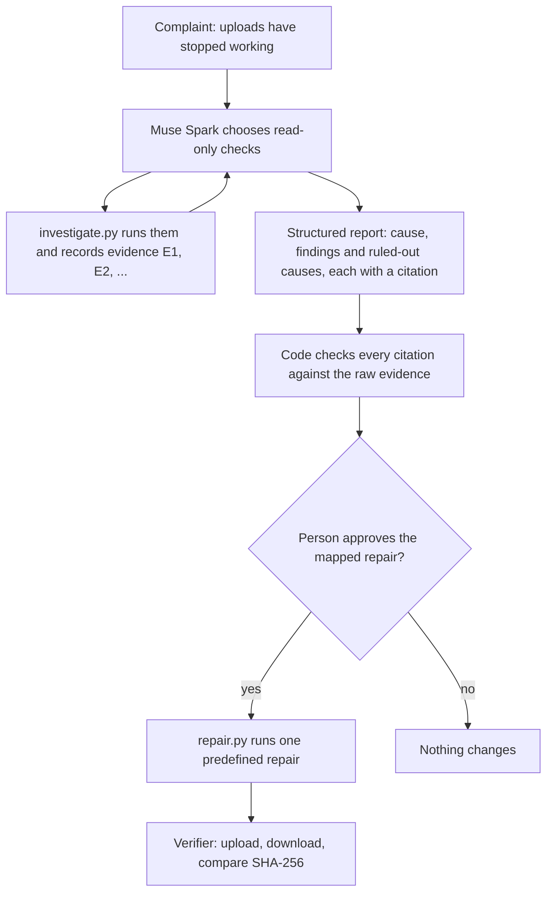

# IncidentLab

IncidentLab investigates why a Docker app on Linux has stopped working, explains the cause with evidence that code checks, and verifies that an approved fix actually restored what the user was trying to do.

Built for the Meta Global AI Developer Hackathon (Indie developer track) with Muse Spark on Meta Model API, and with Muse Code.

**Demo video:** https://youtu.be/-jymOnRLxes

## The problem

When someone reports that uploads have stopped working, the usual signals can mislead. A health check can pass while every upload fails. A database container can report healthy while the app can't reach it. And after a fix, a running container doesn't show that uploads work again.

IncidentLab is a focused prototype for this situation: one self-hosted app (a file-upload service with a Postgres database) in a test VM, and three kinds of failure: a full volume, a directory the app can't write to, and an unavailable database.

## What it does

1. **Investigates.** Given the complaint, Muse Spark chooses from seven read-only checks: the lab's containers, a container's details, its logs, disk and inode usage, directory permissions, Docker events and the app's health endpoint. It often runs several at once, up to 12 per investigation.
2. **Records evidence.** Each check result gets an ID (E1, E2, …).
3. **Reports.** The model writes a structured report: the cause, its findings and the causes it ruled out, each citing an evidence ID, a field and the exact value, plus any open questions. "Healthy" and "insufficient evidence" are valid answers.
4. **Checks every citation.** Code compares each citation with the raw evidence and marks it supported or unsupported. The schema guarantees the report's format, not that its claims are true.
5. **Answers follow-up questions** using the same evidence. On the demo page, answers cite evidence in the same format and are checked by the same code.
6. **Repairs only with approval.** Each diagnosis maps to one predefined repair in code, and nothing changes until a person approves it.
7. **Verifies recovery the way a user would.** It uploads a random 1 MB file, downloads it, compares SHA-256 hashes and deletes the test file. Recovery counts only if that round trip works.



The demo page shows each check as it runs, with a one-line summary and the raw data. It shows the report with every citation marked supported or unsupported; clicking a citation jumps to the evidence it points to. Follow-up questions and the repair approval are on the same page.

## Design choices

- **The model chooses checks, never actions.** Checks are read-only and allowlisted: the model picks from fixed containers and paths, and code validates every argument, because tool-call arguments aren't guaranteed to match their schema. Nothing runs through a shell.
- **Citations are verified, not trusted.** A citation passes only if the cited value appears in the cited field of the cited evidence item.
- **The model doesn't diagnose by elimination.** It is told that the three causes are not the only possible problems, and that it shouldn't conclude a cause only because the others are ruled out.
- **The investigator never learns which fault was injected.** Fault injection lives in `lab/faults.py`, and nothing the checks can read names the fault: no telltale file names, container labels or messages. The app's `/health` endpoint answers only `ok` or `unhealthy`.
- **Stateless requests.** Each request resends the whole conversation, including the model's encrypted reasoning, with `store: false`. Chaining requests with `previous_response_id` failed intermittently during testing (see [Notes](#notes-on-meta-model-api-and-muse-code)).

## Use of Meta products

- **Muse Spark** (`muse-spark-1.3`) through Meta Model API's Responses API, in Standard mode, where Meta doesn't use the content to train its models.
- **Tool calling**, including parallel calls, to choose checks.
- **Structured output** with a strict JSON schema for the incident report and, on the demo page, for follow-up answers.
- **Reasoning** at medium effort, carried across turns with encrypted reasoning replay.
- **Muse Code**, Meta's coding agent, built most of the lab, the evaluation harness and the demo page, working one reviewed step at a time from [`AGENTS.md`](AGENTS.md).

The OpenAI Python SDK is used only as the HTTP client for Meta Model API, as Meta's docs recommend; every model call goes to `api.meta.ai`.

An investigation costs about 5 cents, estimated from token usage at Meta's published Standard prices.

## Evaluation

IncidentLab was run on 15 cases in the lab, three times each (45 runs), and compared with a rule-based baseline that runs the same checks in a fixed order. The expected answers and the baseline's rules were committed before any run with the model, and the case setups were fixed before the full run (changes during the dry runs are listed below). See [`eval/PLAN.md`](eval/PLAN.md) and its git history.

- Every run starts from freshly recreated containers, so no evidence carries over from the previous case.
- Each fault case includes one failed upload, as the user reporting the problem would have made.
- The investigator gets the same complaint every time, "Uploads have stopped working. Find out what is happening.", including in the healthy cases, so the prompt never reveals the case.
- Model settings: `muse-spark-1.3` in Standard mode, medium reasoning effort, at most 12 checks per investigation.
- Results are in [`eval/results/full-1/`](eval/results/full-1/): `runs.jsonl` has one line per run, and `summary.md` is generated from it.

The run was interrupted after 29 runs and resumed about 16 hours later, starting at H1 run 3. Runs 30–45 are labelled `3fdc746-dirty` because, when the run resumed, the runner counted its own result files from the first part as uncommitted changes. Every file the runs use matched commit `3fdc746` byte for byte, and none had been modified since before the first result was written, so all 45 runs used the same evaluation code. Each run starts from freshly recreated containers, so the pause carried nothing over between runs.

### Results

| | IncidentLab | Rule-based baseline |
|---|---|---|
| Fault runs correct | 27 / 27 | 24 / 27 |
| Healthy runs correct | 8 / 9 | 9 / 9 |
| Missing-evidence runs correct | 9 / 9 | 9 / 9 |
| **All runs** | **44 / 45** | **42 / 45** |
| False alarms (a fault named on a healthy case) | 0 | 0 |

- **Citations:** 339 of 343 citations (99%) passed the check. The other four (one in V2, one in D2, two in D3) were flagged as unsupported in their reports.
- **Recovery:** IncidentLab's diagnosis led to a repair in 30 runs, and every one of those repairs restored uploads, as shown by the verifier's upload round trip. In M1 and M2, IncidentLab correctly declined to name a cause, so no repair ran. During the evaluation, repairs ran without the approval prompt.
- **Cost and time:** about $2.37 for all 45 runs, estimated from token usage at Meta's published Standard prices (about 5 cents per investigation), and about 25 seconds per investigation. In 17 of the 45 runs the model used all 12 checks it was allowed.

### Per case

A ✓ means the answer matched the expected one. The baseline gave the same answer in all three runs of every case.

| Case | What it tests | Expected | IncidentLab (runs 1, 2, 3) | Baseline |
|---|---|---|---|---|
| V1 | Stale partial uploads fill the volume | volume_full | ✓ ✓ ✓ | ✓ |
| V2 | Inodes exhausted while space is still free | volume_full | ✓ ✓ ✓ | ✓ |
| V3 | Nearly full: `/health` passes, 1 MB uploads fail | volume_full | ✓ ✓ ✓ | ✓ |
| P1 | Upload directory owned by root | upload_dir_not_writable | ✓ ✓ ✓ | ✓ |
| P2 | Write permission removed from the upload directory | upload_dir_not_writable | ✓ ✓ ✓ | ✓ |
| P3 | Staging directory not writable while `/health` passes | upload_dir_not_writable | ✓ ✓ ✓ | healthy |
| D1 | Database stopped | database_unavailable | ✓ ✓ ✓ | ✓ |
| D2 | Database paused | database_unavailable | ✓ ✓ ✓ | ✓ |
| D3 | Database off the app's network but still reporting healthy | database_unavailable | ✓ ✓ ✓ | ✓ |
| H1 | Clean lab | healthy | ✓ ✓ ✓ | ✓ |
| H2 | Database restarted and recovered; restart errors in the log | healthy | ✓ ✓ ✓ | ✓ |
| H3 | Earlier full disk, already cleaned up; old errors in the log | healthy | ✓, insufficient_evidence, ✓ | ✓ |
| M1 | P1 with the directory-access check and logs unavailable | insufficient_evidence | ✓ ✓ ✓ | ✓ |
| M2 | V1 with disk usage and logs unavailable | insufficient_evidence | ✓ ✓ ✓ | ✓ |
| M3 | D1 with logs unavailable | database_unavailable | ✓ ✓ ✓ | ✓ |

M1 and M2 expect `insufficient_evidence`, because a cause reached only by ruling out the other two counts as wrong: the three causes are not the only problems a real system can have. In M3 the remaining checks still show the cause directly.

### The misses

- **Baseline, P3 (all three runs).** The upload directory itself is writable, so `/health` passes, and the rules reported the system healthy while every upload was failing. IncidentLab found the cause from the permission errors in the app log in all three runs.
- **IncidentLab, H3 run 2.** The log showed an earlier "No space left on device" error followed by a successful upload. IncidentLab answered `insufficient_evidence` instead of `healthy`. It raised no false alarm, but the run counts as wrong.

### How to read these numbers

- With 15 cases, the difference between IncidentLab and the baseline comes down to one case, P3. The results show where each approach fails, not a general accuracy figure.
- The baseline checks `/health` before reading the logs, the way most operators would. That order was fixed before any run (decision 3 in `eval/PLAN.md`), knowing it would probably miss P3. Reading the logs first would probably catch P3 but raise false alarms on H2 and H3, whose logs contain old errors; that variant wasn't run.
- A short list of rules does well when the possible faults are few and known in advance, as they are here. IncidentLab's advantage showed where the obvious checks pass but other evidence disagrees (P3), and in explanations whose every citation is checked.

### Changes made during harness testing and dry runs

Before the full run, the evaluation was rehearsed with one run per case. The dry runs are kept in `eval/results/` and labelled as such. One early attempt was deleted: every model call in it had failed because of a setup error, so it contained no results. These problems were fixed along the way:

1. **V1 left a little free space,** so `/health` passed and V1 overlapped with V3. V1 now fills the volume completely. This was found while testing the harness without the model.
2. **Linked requests failed.** Requests that referred back to the previous response kept failing with "referenced response not found or expired", in 4 of the 15 runs of one dry run. A retry with waits of up to 8 seconds didn't help. `investigate.py` now sends the whole conversation with every request instead.
3. **The missing-evidence cases didn't hide their checks from the model,** only from the baseline. This was a bug in the runner.
4. **P3 left no evidence of the fault,** because nothing tried an upload after the fault was injected. This came to light when the model answered `healthy` on P3 in a dry run. Each fault case now includes one failed upload, as the user reporting the problem would have made.
5. **The runner was hardened.** It now checks that the API key is well-formed and stops after two model errors in a row.

None of these changed the model's instructions, checks, report format or settings, which were fixed before the first dry run.

### Changes since the evaluated commit

The evaluation ran on commit `3fdc746`. Since then: the demo page; an optional progress callback and an optional structured follow-up mode in `investigate.py`, both off by default, so the command-line investigation behaves as it did in the evaluation; the per-case table in `eval/summarize.py`; two runner fixes (commit labelling now ignores `eval/results/`, and each run records its start time); and this README and `requirements.txt`. To reproduce the evaluation exactly, check out `3fdc746`.

## Run it yourself

You need a disposable Ubuntu VM and a Meta Model API key (create one in the [Model API dashboard](https://dev.meta.ai/) under API keys). Don't use your workstation: the fault scripts and repairs use Docker, which is root-equivalent. These steps use Lima on a Mac; any Ubuntu VM works from step 2.

**1. Create the VM** (on the Mac). `--mount-none` keeps your Mac's files out of the VM.

```bash
limactl start --name=incidentlab --mount-none template:default
limactl shell incidentlab
```

Then, in the VM:

```bash
git clone https://github.com/rishi1700/incidentlab.git
cd incidentlab
```

**2. Install Docker and create the 512 MB test filesystem** for the app's data:

```bash
curl -fsSL https://get.docker.com -o get-docker.sh && sudo sh get-docker.sh
sudo usermod -aG docker "$USER"

sudo fallocate -l 512M /srv/lab-data.img
sudo mkfs.ext4 -q -F /srv/lab-data.img
sudo mkdir -p /srv/lab-data
echo '/srv/lab-data.img /srv/lab-data ext4 loop 0 0' | sudo tee -a /etc/fstab
sudo systemctl daemon-reload && sudo mount /srv/lab-data
sudo mkdir -p /srv/lab-data/uploads /srv/lab-data/tmp
sudo chown -R 1000:1000 /srv/lab-data
```

Restart the VM so the `docker` group applies; with Lima, logging out isn't enough. On the Mac: `limactl stop incidentlab && limactl start incidentlab`. Back in the VM, `id -nG` should include `docker`, and `findmnt /srv/lab-data` should show a loop device.

**3. Create the Python environment** (tested with Python 3.14):

```bash
sudo apt-get update && sudo apt-get install -y python3-venv
python3 -m venv .venv && .venv/bin/pip install -r requirements.txt
```

**4. Start the lab and check that uploads work:**

```bash
docker compose -f lab/compose.yaml up -d --build
python3 lab/verify.py
```

**5. Break something and investigate:**

```bash
read -rsp "Meta API key: " MODEL_API_KEY; echo; export MODEL_API_KEY
python3 lab/faults.py inject P3      # every case is described in eval/PLAN.md
python3 lab/verify.py                # fails, leaving the failed upload a real user would
.venv/bin/python investigate.py      # follow-up questions, then the repair prompt
```

For the demo page, run `.venv/bin/python web/server.py` and open http://127.0.0.1:8090 (from the Mac, with Lima: http://localhost:8090). The server listens only on 127.0.0.1 and has no login.

`python3 lab/faults.py reset all` puts the lab back. `inject` refuses to run unless the lab is healthy first.

Settings are environment variables: `INCIDENTLAB_MODEL`, `INCIDENTLAB_EFFORT`, `INCIDENTLAB_MAX_CHECKS`, and `INCIDENTLAB_UNAVAILABLE_CHECKS` (a comma-separated list of checks to make unavailable).

**6. Run the evaluation:**

```bash
.venv/bin/python eval/run.py --runs 3 --results-dir eval/results/my-run
python3 eval/summarize.py eval/results/my-run
```

Running the same command again resumes an interrupted run. `--no-model` runs everything except the model, which tests the harness for free. A full run of 45 cost about $2.40.

**Tests** use fake clients and don't call the model:

```bash
.venv/bin/python -m unittest tests.test_investigate tests.test_repair tests.test_faults tests.test_run tests.test_summarize tests.test_web
```

## Repository layout

| Path | What it is |
|---|---|
| `investigate.py` | The investigator: checks, model loop, report and citation checking |
| `repair.py` | The approval prompt, the three predefined repairs and the verifier |
| `lab/` | The upload app and Postgres (`compose.yaml`, `app/`); `faults.py`, which injects, resets and reports every case and is the only code that knows which fault is active; `verify.py`; and re-runnable lab checks (`check_*.sh`) |
| `eval/` | `PLAN.md` (cases, expected answers and decisions), `cases.json`, `baseline.py`, `run.py`, `summarize.py` and `results/` |
| `web/` | The demo page (`server.py`, `index.html`) |
| `tests/` | Unit tests |
| `runs/` | Records of individual investigations from development |
| `AGENTS.md` | The brief Muse Code worked from |

## Notes on Meta Model API and Muse Code

Things I ran into, in case they help others:

- **Chained requests failed intermittently.** Requests with `previous_response_id` sometimes failed with 400 "referenced response not found or expired": in 3 of 7 runs of one dry run and 4 of 15 runs of the next, and retrying for up to 15 seconds didn't help. Stateless replay (`store: false` with encrypted reasoning) has had no such failures in the 60 runs since (one dry run and the full evaluation). Investigations also took about 25–30 seconds on average instead of 50–150, though that wasn't a controlled comparison.
- **Per-request settings.** `instructions`, `tools` and the reasoning effort have to be sent with every request; they don't carry over between turns.
- **`tool_choice` only supports `auto`,** so the loop has to handle a plain-text answer at any turn.
- **Muse Code on Ubuntu.** The documented `curl -fsSL https://dev.meta.ai/install.sh | sh` fails because the script needs bash; `| bash` works. Its bubblewrap sandbox needed `kernel.apparmor_restrict_unprivileged_userns=0`, which I set in the lab VM only. On its first run with a pay-as-you-go key, Muse Code 1.4.11 tried to use `muse-wonder-full-1.0`, which those keys can't use; starting it with `--model muse-spark-1.3` fixed it.

## Limitations

- **The lab is small and synthetic:** one app, one database, three causes. The report can name only these three causes, so anything else, such as the app container itself having stopped, has to come back as `insufficient_evidence`.
- **Repairs are predefined,** one per cause. The model never chooses an action.
- **The directory-access check reads owner and mode bits only.** It ignores ACLs and supplementary groups, and it covers the upload directory and the data volume, not the staging directory.
- **Follow-up answers weren't evaluated.** On the demo page they're checked the same way as the report; on the command line they're plain text.
- **Evidence leaves the machine.** Logs, paths and container details are sent to Meta Model API, so use IncidentLab only where that's acceptable. The lab uses synthetic data.
- **The results cover one model version on one lab.** They are counts from 45 runs, not a general accuracy figure.

## Possible next steps

- An `other` cause and more failure types, so problems outside the three causes get a proper answer.
- Trying it with teams that run real self-hosted apps, to learn whether diagnosis, evidence gathering or verifying the fix saves them the most time.
- A version that runs on Meta's open-weight models, such as Muse Glimmer, for sites that can't send data to an external API.
